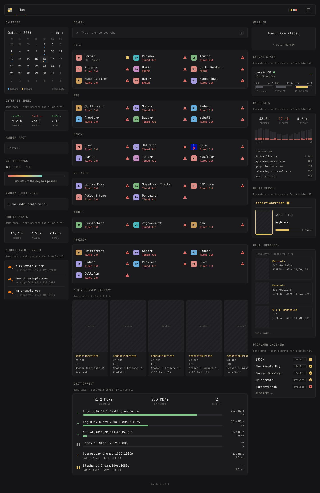
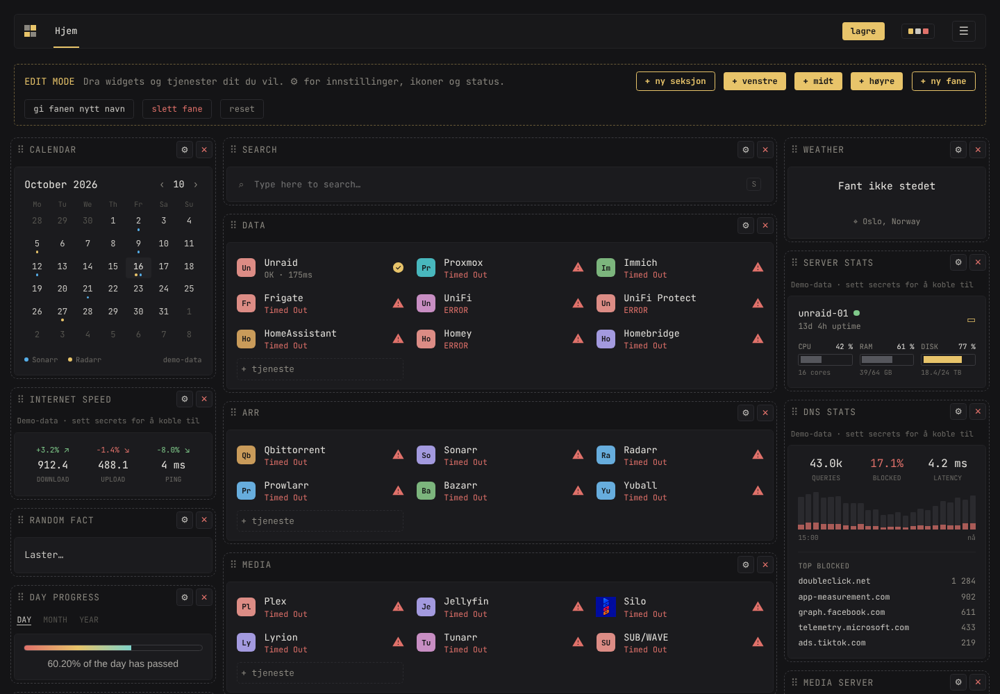
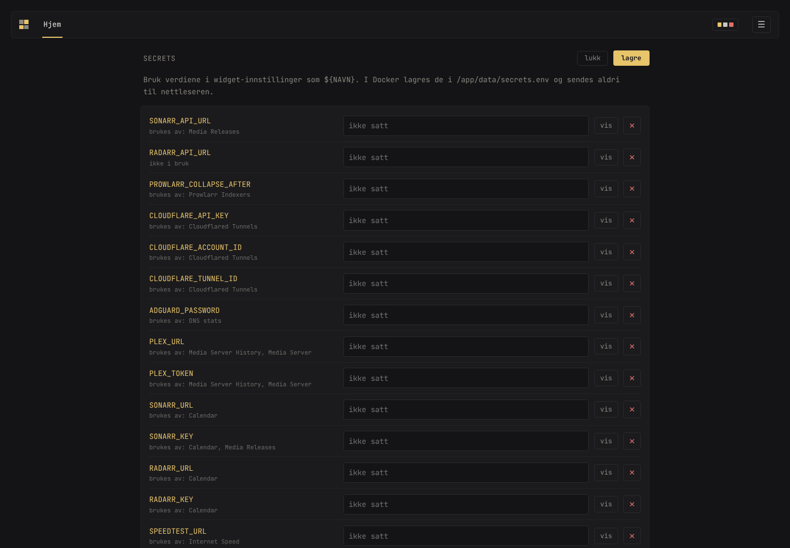

<p align="center">
  
</p>

<h1 align="center">Labdeck</h1>

<p align="center">
  Et selvhostet homelab-dashboard med <b>GUI-editor</b> – dra og slipp widgets, ingen YAML.<br>
  Én Docker-container for <b>Unraid</b>, <b>TrueNAS</b>, <b>Portainer</b> og <b>Proxmox</b>.
</p>

<p align="center">
  
  
  
</p>

<p align="center">
  
</p>

> **Inspirert av [Glance](https://github.com/glanceapp/glance).** Utseendet, widgetene og `custom-api`-oppsettene
> (Plex-historikk, Media Releases, qBittorrent, Prowlarr, Cloudflared tunnels m.fl.) er hentet fra Glance og
> fellesskapets widgets. Forskjellen er at Labdeck konfigureres i nettleseren i stedet for i en YAML-fil.
> Takk til Glance-prosjektet og alle som har delt widgets!

---

## Innhold

- [Funksjoner](#funksjoner)
- [Installasjon](#installasjon)
  - [Unraid (Docker-fanen)](#unraid-docker-fanen)
  - [Portainer](#portainer)
  - [TrueNAS SCALE](#truenas-scale)
  - [Proxmox (LXC)](#proxmox-lxc)
  - [Docker Compose](#docker-compose)
- [Kom i gang](#kom-i-gang)
- [Secrets](#secrets)
- [Widgets](#widgets)
- [Oppdatere](#oppdatere)
- [Hvordan det fungerer](#hvordan-det-fungerer)
- [Feilsøking](#feilsøking)
- [Sikkerhet](#sikkerhet)

---

## Funksjoner

| | |
|---|---|
| 🖱️ **GUI-editor** | Dra widgets og tjenester dit du vil. Legg til, endre og slett alt fra nettleseren. |
| 🗂️ **Faner** | Lag egne faner (f.eks. *Hjem*, *Hytta*, *Skole*), gi dem nytt navn eller slett dem. |
| 🟢 **Status-sjekk** | Hver tjeneste pinges hvert minutt: `OK · 31ms`, `ERROR` eller `Timed Out`. |
| 🔐 **Secrets på serveren** | API-nøkler skrives som `${NAVN}` og fylles inn av backend – nettleseren ser dem aldri. |
| 🎨 **5 temaer** | Amber, Frost, Moss, Rose og Paper (lyst). |
| 📱 **Mobilvisning** | Én kolonne på små skjermer. |
| 🔎 **Søk** | Trykk `S` eller `/`. Søker i tjenestene dine, åpner URL/IP direkte, støtter `!yt !gh !r !w`. |

<table>
  <tr>
    <td width="50%"><p align="center"><sub>Edit mode – dra og slipp</sub></p></td>
    <td width="50%"><p align="center"><sub>Secrets – maskert, lagres på serveren</sub></p></td>
  </tr>
</table>

---

## Installasjon

Imaget bygges automatisk av GitHub Actions og ligger på
`ghcr.io/sebastiankristo/glass-dash:latest` (amd64 og arm64).

Labdeck trenger bare to ting:

| Hva | Verdi | Forklaring |
|---|---|---|
| **Port** | `7575` | Nettsiden. |
| **Mappe** | `/app/data` | Her lagres oppsettet og secrets. **Må** mappes til en mappe på disken, ellers mister du alt ved oppdatering. |

### Unraid (Docker-fanen)

#### Alternativ 1 – med template (anbefalt)

Templaten fyller inn alt automatisk, inkludert ikon og felt for alle secrets.

1. Åpne terminalen i Unraid (`>_` øverst til høyre) og kjør:
   ```bash
   wget -O /boot/config/plugins/dockerMan/templates-user/my-labdeck.xml \
     https://raw.githubusercontent.com/sebastiankristo/glass-dash/main/unraid/labdeck.xml
   ```
2. Gå til **Docker → Add Container**.
3. Velg **labdeck** i *Template*-lista.
4. Klikk **Show more settings …** og fyll inn secrets du vil bruke. Tomme felt kan stå tomme.
5. Trykk **Apply** og åpne via **WebUI** i Docker-fanen.

#### Alternativ 2 – manuelt

Gå til **Docker → Add Container** og fyll inn:

| Felt | Verdi |
|---|---|
| **Name** | `Labdeck` |
| **Repository** | `ghcr.io/sebastiankristo/glass-dash:latest` |
| **Network Type** | `Bridge` *(enklest)* eller `Custom: br0` *(egen IP)* |
| **Fixed IP** | Kun ved br0, f.eks. `10.69.1.50` |
| **Icon URL** *(Show more settings)* | `https://raw.githubusercontent.com/sebastiankristo/glass-dash/main/public/icon.png` |

Klikk så **Add another Path, Port, Variable, Label or Device** og legg til:

| Type | Container | Host / verdi |
|---|---|---|
| **Path** | `/app/data` | `/mnt/user/appdata/labdeck` |
| **Port** *(kun Bridge)* | `7575` | `7575` |
| **Variable** *(valgfritt)* | f.eks. `PLEX_TOKEN` | tokenet ditt |

Trykk **Apply**.

> **Bridge eller br0?**
> - **Bridge:** containeren deler IP med Unraid. Dashbordet ligger på `http://<unraid-ip>:7575`.
> - **br0:** containeren får sin egen IP på nettverket. Dashbordet ligger på `http://<fast-ip>:7575`. Port-mapping brukes ikke her.

### Portainer

#### Fra Git-repoet (bygges på din server)

1. **Stacks → Add stack → Repository**
2. **Repository URL:** `https://github.com/sebastiankristo/glass-dash`
3. **Reference:** `refs/heads/main`
4. **Compose path:** `docker-compose.build.yml`
5. *(Valgfritt)* **Environment variables → Load variables from .env file** for secrets.
6. **Deploy the stack.**

Tips: Skru på **GitOps updates → Polling** så henter Portainer nye versjoner selv.

#### Fra ferdig image

**Stacks → Add stack → Web editor**, lim inn innholdet fra [`docker-compose.yml`](docker-compose.yml) og trykk **Deploy**.

### TrueNAS SCALE

Gjelder **TrueNAS SCALE 24.10 (Electric Eel) og nyere**, som bruker Docker for apper.

#### 1. Lag en mappe til data
1. **Datasets** → velg poolen (f.eks. `tank`) → **Add Dataset**.
2. Navn: `apps/labdeck` (lag `apps` først hvis den ikke finnes). Preset: **Apps**.
3. **Save**. Stien blir `/mnt/tank/apps/labdeck`.

#### 2a. Installer via YAML (raskest)
1. **Apps → Discover Apps** → klikk **⋮** øverst til høyre → **Install via YAML**.
2. **Name:** `labdeck`
3. Lim inn innholdet fra [`truenas/docker-compose.yml`](truenas/docker-compose.yml) og bytt `tank` med navnet på poolen din.
4. **Save**. Åpne `http://<truenas-ip>:7575`.

#### 2b. Eller via skjemaet (Custom App)
**Apps → Discover Apps → Custom App** og fyll inn:

| Felt | Verdi |
|---|---|
| **Application Name** | `labdeck` |
| **Image → Repository** | `ghcr.io/sebastiankristo/glass-dash` |
| **Image → Tag** | `latest` |
| **Restart Policy** | `Unless Stopped` |
| **Ports** | Container `7575` → Host `7575`, TCP |
| **Storage → Host Path** | Host path `/mnt/tank/apps/labdeck` → Mount path `/app/data` |
| **Environment Variables** *(valgfritt)* | f.eks. `PLEX_TOKEN` = tokenet ditt |
| **Portal** *(valgfritt)* | Port `7575` – gir en *Web UI*-knapp i Apps |

Trykk **Install**.

> **Port opptatt?** TrueNAS bruker selv 80/443. 7575 er normalt ledig, men bytt host-porten (f.eks. `7576:7575`) om du får feil.

**Oppdatere på TrueNAS:** **Apps** → velg `labdeck` → **Update** når den vises, eller **⋮ → Pull Image** og så **Restart**.

> Eldre TrueNAS SCALE (23.10 *Cobia* / 24.04 *Dragonfish*) bruker Kubernetes. Bruk da **Custom App**-skjemaet over – feltene er de samme. *TrueNAS CORE* har ikke Docker; kjør Labdeck i en VM eller på en annen maskin.

### Proxmox (LXC)

Et helper-script lager en liten Debian 12-container og installerer Labdeck direkte (Node.js, uten Docker).

1. Åpne **Shell** på Proxmox-noden (ikke inne i en VM/LXC).
2. Kjør:
   ```bash
   bash -c "$(curl -fsSL https://raw.githubusercontent.com/sebastiankristo/glass-dash/main/proxmox/labdeck-lxc.sh)"
   ```
3. Svar på spørsmålene (Enter = standard):

   | Spørsmål | Standard | Forklaring |
   |---|---|---|
   | Container-ID | neste ledige | f.eks. `150` |
   | Hostname | `labdeck` | |
   | Disk-lagring | `local-lvm` | f.eks. `local-zfs` |
   | Nettverksbro | `vmbr0` | |
   | IP | `dhcp` | eller fast, f.eks. `10.69.1.50/24` (spør da om gateway) |

4. Når scriptet er ferdig, skriver det ut adressen, f.eks. `http://10.69.1.50:7575`.

Containeren får 1 kjerne, 512 MB RAM og 4 GB disk, og starter automatisk med Proxmox.

**Uten spørsmål** (alt via variabler):
```bash
UNATTENDED=1 CTID=150 STORAGE=local-zfs NET=10.69.1.50/24 GATEWAY=10.69.1.1 \
  bash -c "$(curl -fsSL https://raw.githubusercontent.com/sebastiankristo/glass-dash/main/proxmox/labdeck-lxc.sh)"
```

| Hva | Hvor |
|---|---|
| Oppdatere | `pct exec <ID> -- update-labdeck` (fra Proxmox-shell) |
| Data | `/opt/labdeck-data` i containeren |
| Secrets som variabler *(valgfritt)* | `/opt/labdeck-data/labdeck.env` (`NAVN=verdi` per linje), så `systemctl restart labdeck` |
| Logg | `pct exec <ID> -- journalctl -u labdeck -f` |

> Vil du heller kjøre Docker i Proxmox, bruk [Docker Compose](#docker-compose) i en VM eller LXC med Docker.

### Docker Compose

```yaml
services:
  labdeck:
    image: ghcr.io/sebastiankristo/glass-dash:latest
    container_name: labdeck
    ports:
      - "7575:7575"
    volumes:
      - /mnt/user/appdata/labdeck:/app/data   # Proxmox/annet: ./data
    restart: unless-stopped
```

```bash
docker compose up -d
```

---

## Kom i gang

1. Åpne `http://<ip>:7575`.
2. Klikk **☰ → ✎ Rediger** for å gå i edit mode.
3. Bruk knappene øverst:
   - **+ ny seksjon** – ny gruppe med tjenester (f.eks. *Media*).
   - **+ venstre / midt / høyre** – åpner widget-biblioteket for den kolonnen.
   - **+ ny fane / gi fanen nytt navn / slett fane** – administrer faner.
   - **reset** – tilbakestiller *bare* fanen du står i.
4. Dra widgets og tjenester med musa. **⚙** åpner innstillinger, **✕** sletter.
5. Klikk på en tjeneste for å endre navn, URL, ikon og status.
6. Trykk **lagre** øverst.

**Tjeneste-status**

| Valg | Betydning |
|---|---|
| `auto` | Serveren sjekker URL-en hvert minutt (timeout 6 s). |
| `up` / `down` | Tving status manuelt. |
| `off` | Ingen statusprikk. |

**Ikoner** hentes automatisk fra [homarr-labs/dashboard-icons](https://github.com/homarr-labs/dashboard-icons)
basert på navnet. Du kan også lime inn en egen URL eller laste opp PNG/SVG.

---

## Secrets

Secrets er API-nøkler, tokens, passord og adresser. I widget-innstillingene skriver du
**navnet** i stedet for verdien, f.eks. `${PLEX_TOKEN}`. Serveren bytter inn den ekte verdien når den henter data.

Du kan legge dem inn på to måter:

1. **I dashbordet:** **☰ → Secrets** → fyll inn → **lagre**.
2. **Som miljøvariabler** på containeren (Unraid *Variable*, Portainer *Environment variables* eller en `.env`-fil).

Verdier i dashbordet går foran miljøvariabler.

<details>
<summary><b>Alle secret-navn</b> (klikk for å vise)</summary>

| Navn | Brukes av | Eksempel |
|---|---|---|
| `PLEX_URL` | Media Server, History | `http://10.69.1.126:32400` |
| `PLEX_TOKEN` | Media Server, History | Plex-token |
| `SONARR_URL` / `SONARR_API_URL` | Calendar, Media Releases | `http://10.69.1.126:8989` |
| `SONARR_KEY` | Calendar, Media Releases | Settings → General |
| `RADARR_URL` / `RADARR_API_URL` | Calendar | `http://10.69.1.126:7878` |
| `RADARR_KEY` | Calendar | Settings → General |
| `PROWLARR_URL` / `PROWLARR_API_URL` | Prowlarr Indexers | `http://10.69.1.126:9696` |
| `PROWLARR_KEY` | Prowlarr Indexers | Settings → General |
| `PROWLARR_COLLAPSE_AFTER` | Prowlarr Indexers | `5` |
| `QBITTORRENT_IP` | qBittorrent | `10.69.1.126:8080` |
| `SPEEDTEST_URL` | Internet Speed | `http://10.69.1.202` |
| `SPEEDTEST_TRACKER_API_TOKEN` | Internet Speed | API-token |
| `IMMICH_URL` / `IMMICH_API_KEY` | Immich stats | `http://10.69.1.126:2283` |
| `CLOUDFLARE_ACCOUNT_ID` | Cloudflared Tunnels | Account ID |
| `CLOUDFLARE_TUNNEL_ID` | Cloudflared Tunnels | Tunnel ID |
| `CLOUDFLARE_API_KEY` | Cloudflared Tunnels | Token med *Cloudflare Tunnel: Read* |
| `DNS_URL` | DNS stats | `http://10.69.1.x:3000` |
| `ADGUARD_PASSWORD` | DNS stats | AdGuard-passord |
| `PORTAINER_URL` / `PORTAINER_ENDPOINT_ID` / `PORTAINER_API_KEY` | Portainer | |
| `GLANCES_URL` | Server stats | `http://10.69.1.126:61208` |
| `PROXMOX_URL` / `PROXMOX_TOKEN` | Server stats | `user@pam!id=secret` |

</details>

---

## Widgets

| Widget | Kilde | Merknad |
|---|---|---|
| **Calendar** | Sonarr + Radarr | Klikk en dag for å se hva som kommer. |
| **Internet Speed** | Speedtest Tracker | Ned/opp/ping med endring mot snitt. |
| **Weather** | Open-Meteo | Ingen nøkkel. Hold over en time for detaljer. |
| **Server stats** | Glances eller Proxmox | CPU, RAM, disk, oppetid. |
| **DNS stats** | AdGuard Home eller Pi-hole | Spørringer, blokkert %, 24-timers graf, topp blokkert. |
| **Media Server** | Plex, Jellyfin, Emby, Tautulli | Hva som spilles nå. |
| **Media Server History** | Plex, Jellyfin, Emby, Tautulli | Karusell med sist sett. |
| **Media Releases** | Sonarr, Radarr, Lidarr | Kommende, nylige eller manglende. |
| **qBittorrent** | qBittorrent Web UI | Krever *Bypass authentication for clients on localhost/whitelist*. |
| **Prowlarr Indexers** | Prowlarr | Privacy-merke og status. |
| **Cloudflared Tunnels** | Cloudflare API | Hostname → tjeneste. |
| **Immich stats** | Immich | Bilder, videoer, lagring. |
| **Portainer** | Portainer API | Containere og status. |
| **Day progress** | Lokalt | Dag, måned eller år. |
| **Random fact / Bible verse** | Offentlige API-er | |
| **Search** | DuckDuckGo, Google, Bing, Startpage | Søkemotor velges i ☰-menyen. |

Uten secrets viser API-widgetene **demo-data**, merket *«Demo-data · sett secrets for å koble til»*.

---

## Oppdatere

| Hvor | Slik gjør du |
|---|---|
| **Unraid** | Docker-fanen → klikk Labdeck-ikonet → **Force update** |
| **Proxmox LXC** | `pct exec <ID> -- update-labdeck` |
| **TrueNAS** | Apps → labdeck → **Update** (eller **⋮ → Pull Image** + Restart) |
| **Portainer (Git)** | Stacks → labdeck → **Pull and redeploy** |
| **Portainer (image)** | Stacks → labdeck → **Update the stack** med *Re-pull image* |
| **Compose** | `docker compose pull && docker compose up -d` |

Gjør en hard refresh i nettleseren etterpå (`Ctrl+Shift+R` / `Cmd+Shift+R`).
Oppsettet ditt i `/app/data` beholdes.

---

## Hvordan det fungerer

```
 Nettleser ──► Labdeck (Node, port 7575) ──► Plex / Sonarr / AdGuard / Cloudflare …
   │                  │
   │  ${PLEX_TOKEN}   │  bytter inn ekte verdi, henter data, cacher 10 s
   ◄──────────────────┘
```

- **Frontend:** Prototypen fra Claude Design (React), servert som statiske filer. React og Babel ligger i imaget, så siden virker uten internett.
- **Backend:** [`server.js`](server.js) – en liten Node-server uten avhengigheter. Den lagrer oppsett, holder secrets og videresender alle API-kall. Det løser CORS-problemer og holder nøklene unna nettleseren.
- **Lagring:**
  - `/app/data/config.json` – faner, widgets, tema.
  - `/app/data/secrets.json` – secrets.

---

## Feilsøking

| Problem | Løsning |
|---|---|
| Widget viser **ERROR … HTTP 401** | Feil API-nøkkel. Sjekk secret-verdien (lett å forveksle `l`/`I`/`1` og `O`/`0`). |
| Widget viser **Demo-data** | Secret mangler eller er tom. Se ☰ → Secrets. |
| Alle tjenester **Timed Out** | Containeren når ikke LAN-et. Med br0: sjekk IP/subnet. Med Bridge: sjekk at Unraid når tjenestene. |
| **Fant ikke stedet** (Weather) | Skriv stedet som `By, Land`, f.eks. `Oslo, Norway`. |
| Ikoner mangler | Nettleseren må nå `cdn.jsdelivr.net`. Ellers: lim inn egen ikon-URL eller last opp fil. |
| Endringer vises ikke etter oppdatering | Hard refresh (`Ctrl+Shift+R`). |
| Ikon vises ikke i Unraid | Sett **Icon URL** under *Show more settings* (se over). |

---

## Sikkerhet

- **Ikke eksponer port 7575 direkte mot internett.** Backend kan nå alt containeren når i LAN-et ditt. Legg Authelia, Cloudflare Access eller lignende foran hvis du vil nå den utenfra.
- Secrets sendes aldri til nettleseren – den ser bare `${NAVN}`.
- Ikke legg secrets i Git. Bruk Secrets-siden eller miljøvariabler.

---

<p align="center">
  <sub>Design laget med Claude Design · Inspirert av <a href="https://github.com/glanceapp/glance">Glance</a> · Ikoner fra <a href="https://github.com/homarr-labs/dashboard-icons">dashboard-icons</a></sub>
</p>
